# Banking AI Assistant — Enterprise Architecture & Technical Design Document

**Document class:** Technical Design Document (TDD)
**Domain:** Retail Banking Knowledge Assistant (Grounded RAG + Agentic Orchestration)
**Audience:** Principal/Staff Engineers, Platform Architecture Review Board, Security & Compliance
**Status:** Target-state architecture reverse-engineered from the current feature set

---

## 0. Preamble — As-Built vs. Target-State

This document reverse-engineers a **production-ready, Fortune-500-grade** architecture from the observable feature set of the application (grounded Q&A, document upload/ingestion, dashboard telemetry, spreadsheet report export, voice assistant, source citations, confidence scoring). Where the current prototype differs from the recommended production topology, the distinction is called out explicitly:

| Concern | As-Built (current prototype) | Target-State (this document) |
|---|---|---|
| Vector store | In-process FAISS `IndexFlatIP`, rebuilt on mutation | Managed ANN store (Qdrant / pgvector / Azure AI Search) with HNSW |
| Embeddings | `sentence-transformers/all-MiniLM-L6-v2` (local, 384-d) | Azure OpenAI `text-embedding-3-large` (3072-d) with local fallback |
| Generation | Azure OpenAI `o4-mini` (reasoning) via `.env` | Azure OpenAI GPT-4o / o-series behind a model gateway |
| Orchestration | Linear function pipeline in `main.py` | LangGraph stateful multi-agent graph |
| Persistence | JSON KB file + on-disk uploaded chunks | PostgreSQL + object storage + vector DB |
| Auth | Open CORS, no auth | OAuth2/OIDC + JWT + RBAC (Keycloak/Entra ID) |
| Deployment | Uvicorn + Vite dev servers | Kubernetes, Nginx ingress, HPA, CI/CD |

The **algorithms** described for query routing, hallucination detection, confidence scoring, and citation generation reflect the **actual implemented logic**, generalised to production scale.

---

## 1. High-Level Architecture

The system is a layered, service-oriented platform. The AI Layer is isolated behind internal contracts so that model providers, vector stores, and rerankers are swappable without touching the API surface.

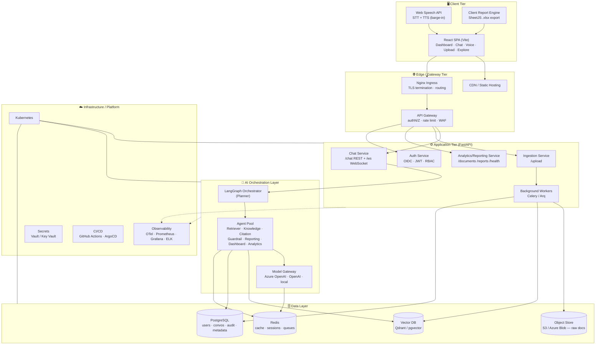

**Layer responsibilities**

- **Frontend (Client Tier).** React 18 SPA built with Vite and Tailwind. Renders the dashboard, chat panel, voice assistant, upload workflow, topic explorer, and knowledge gallery. Owns the client-side report engine (SheetJS) and browser speech (STT/TTS with keyword-gated barge-in). Communicates over REST for request/response and WebSocket for streamed tokens.
- **Backend (Application Tier).** Stateless FastAPI services: Chat (synchronous + streaming Q&A), Ingestion (document upload and async processing), Analytics/Reporting (telemetry, exports, health), and Auth. Horizontally scalable behind the gateway.
- **AI Layer.** A LangGraph orchestrator (the Planner) coordinates specialised agents (retrieval, synthesis, citation, guardrails, reporting, analytics). A Model Gateway abstracts LLM/embedding providers, enforcing timeouts, retries, and cost/latency policies.
- **Data Layer.** PostgreSQL for relational state (users, conversations, audit, document metadata); a managed Vector DB for embeddings and ANN search; Redis for cache, sessions, and work queues; object storage for raw uploaded documents.
- **Infrastructure.** Kubernetes-hosted, with centralized observability (OpenTelemetry → Prometheus/Grafana/Loki + ELK), secrets management (Vault/Key Vault), and GitOps CI/CD.

---

## 2. End-to-End Request Flow — *"How do I get a personal loan?"*

The following is the complete execution path from browser keystroke to grounded, cited answer.

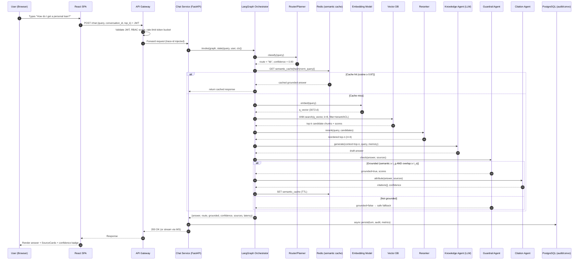

**Narrative.** The SPA issues `POST /chat` with a bearer JWT. The gateway authenticates, authorizes the `chat:invoke` scope, and applies a per-principal token-bucket rate limit before forwarding with a propagated trace ID. The Chat Service invokes the LangGraph graph. The **Planner/Router** classifies the query as in-domain (`kb`, confidence 0.90 via the banking-keyword fast-path). A **semantic cache** lookup short-circuits repeat questions. On a miss, the query is embedded, ANN-searched against the tenant-scoped vector index (k=8), reranked to the top 4, and passed to the **Knowledge Agent**, which synthesises an answer constrained to the retrieved context. The **Guardrail Agent** validates grounding; if it passes, the **Citation Agent** attaches source attributions and a composite confidence score. The turn is persisted asynchronously (conversation history + immutable audit record) and returned. The SPA renders the answer, source cards, and confidence badge.

---

## 3. RAG Pipeline

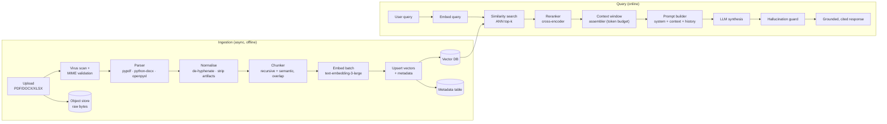

**Stage-by-stage.**

1. **Document Upload.** Multipart upload (`/upload`) accepts PDF/DOCX/XLSX with a category hint. The raw bytes are streamed to object storage; an ingestion job is enqueued. *(As-built: synchronous parse+chunk in-process via `DocumentStore.add_file`.)*
2. **PDF Parsing.** `pypdf` extracts text per page; `python-docx`/`openpyxl` handle Office formats. Production adds layout-aware extraction (e.g., Azure Document Intelligence / Unstructured.io) to preserve **tables** — critical here, because banking policy PDFs are table-heavy (LTV grids, fee schedules) that linearise poorly.
3. **Normalisation.** Repairs extraction artifacts: de-hyphenation across line breaks, control-character stripping, whitespace collapsing, table reconstruction. This directly addresses the observed "garbled chunk" failure mode.
4. **Chunking.** Recursive character splitting with structural awareness (headings, list items, table rows), target ~500–800 tokens with 10–15% overlap to preserve cross-boundary context. Each chunk records `doc_id`, `page`, `section`, `part i/n`, `category`.
5. **Embeddings.** Batched embedding with `text-embedding-3-large` (target) or MiniLM (fallback). Vectors L2-normalised for cosine/inner-product equivalence.
6. **Vector Database.** HNSW index (Qdrant/pgvector) with per-tenant collections and metadata payloads for ACL/category filtering. *(As-built: FAISS `IndexFlatIP` — exact search, rebuilt on mutation.)*
7. **Similarity Search.** Query embedded once; ANN returns top-k (k=8) candidates with cosine scores, pre-filtered by tenant and category ACLs.
8. **Re-ranking.** A cross-encoder (e.g., `bge-reranker-large` or Cohere Rerank) re-scores the k candidates against the full query, promoting precision; top-n (n=4) survive. *(As-built: none — raw ANN order; this is the highest-ROI production addition.)*
9. **Context Window.** A token-budgeted assembler packs the top-n chunks, deduplicates overlaps, orders by relevance, and truncates to fit the model context minus the reserved completion and system-prompt budget.
10. **Prompt Builder.** Composes `system prompt` (role, grounding constraints, refusal contract, anti-verbatim rule) + `context block` (numbered, source-tagged) + `conversation memory` + `user question`.
11. **LLM.** Azure OpenAI generates the answer. Reasoning models (o-series) omit `temperature` and use `max_completion_tokens`; chat models use `temperature≈0.1`.
12. **Hallucination Guard.** Post-generation validation (Section 21). Refusals are preserved; genuinely ungrounded fabrications trigger a safe fallback.
13. **Grounded Response.** The final payload carries `answer`, `route`, `grounded`, `grounding_score`, `overlap`, `confidence`, `sources[]`, and `latency_ms`.

---

## 4. Agent Architecture

The orchestrator is a **LangGraph state machine**. Each node is a bounded, single-responsibility agent operating on a shared, typed `GraphState`. Edges encode routing decisions; the graph supports conditional branches, retries, and early exits.

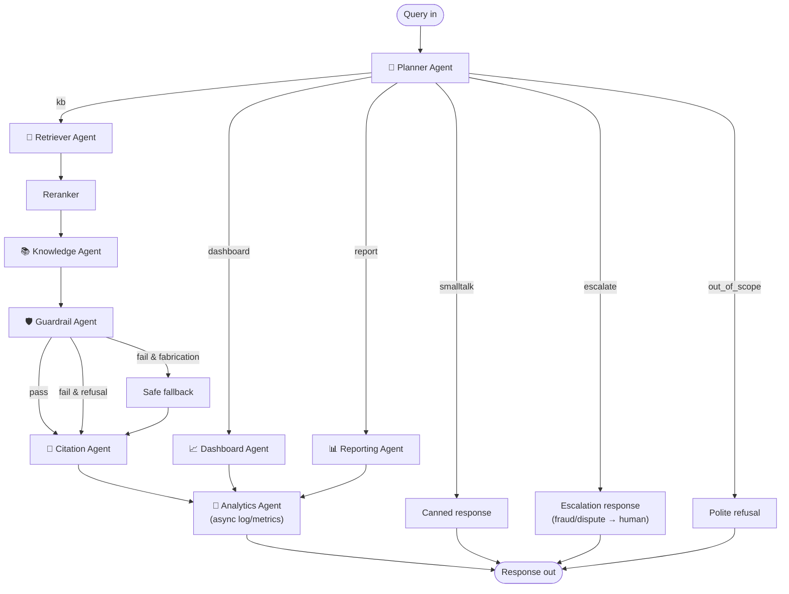

| Agent | Responsibility | Maps to (as-built) |
|---|---|---|
| **Planner Agent** | Classifies intent and routes: `smalltalk`, `escalate`, `out_of_scope`, `kb`, `report`, `dashboard`. Owns policy for when *not* to invoke the LLM. Emits routing confidence. | `query_router.QueryRouter.route()` |
| **Retriever Agent** | Embeds the query, executes ANN search with ACL/category filters, returns candidate chunks with scores. Handles top-k depth and multi-collection fan-out. | `rag_engine.RAGEngine.retrieve()` |
| **Knowledge Agent** | Synthesises a grounded answer from the reranked context under strict prompt constraints (context-only, no fabrication, anti-verbatim, concise). Manages provider fallback. | `llm.generate_answer()` |
| **Reporting Agent** | Produces analytical artefacts (query-log export, usage reports) as `.xlsx`/CSV; applies date-range and tenant filters; streams large exports. | Client `queryLog.js` export + server report endpoint (target) |
| **Dashboard Agent** | Aggregates KB/corpus statistics (document counts, categories, ingestion status, health) for the overview surface. | `RAGEngine.stats()` → `/health` |
| **Analytics Agent** | Records every turn (query, route, grounding, latency, cost, tokens) to the analytics store; computes rolling metrics (deflection rate, grounding rate, p95 latency). | Query-log + audit persistence (target) |
| **Citation Agent** | Builds source attributions: maps answer spans to source chunks, assembles `SourceCard` payloads (title, category, snippet, score), computes composite confidence. | `Source` assembly in `/chat` handler |
| **Guardrail Agent** | Enforces safety and grounding: input filters (PII/prompt-injection), output grounding validation, refusal preservation, fabrication fallback, escalation of sensitive intents. | `hallucination_guard.HallucinationGuard` + router `out_of_scope`/`escalate` + `is_refusal()` |

---

## 5. Backend Components

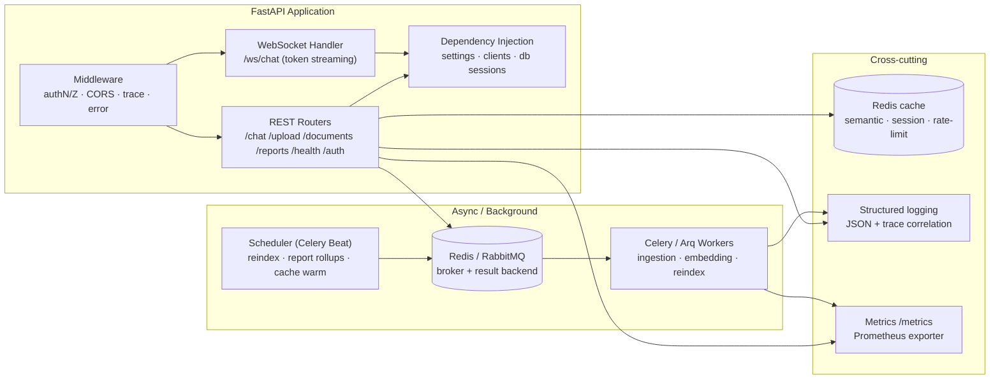

- **FastAPI.** ASGI (Uvicorn/Gunicorn workers) app exposing REST + WebSocket. Pydantic models validate all I/O; dependency injection supplies settings, DB sessions, and provider clients.
- **Authentication.** OAuth2/OIDC bearer flow; JWT validated at gateway and re-verified in-service; scopes/roles injected into request context.
- **REST APIs.** `/chat`, `/upload`, `/documents`, `/documents/{id}` (DELETE), `/reports`, `/health`, `/auth/*`. Versioned under `/api/v1`.
- **WebSocket.** `/ws/chat` streams tokens/events for low-latency, interruptible responses (aligns with the voice assistant's barge-in UX).
- **Background Workers.** Celery/Arq perform document parsing, chunking, embedding, and vector upserts off the request path; retried with exponential backoff and dead-letter queues.
- **Redis.** Serves as broker/result backend, semantic cache, session store, and rate-limit counter store.
- **Caching.** Multi-tier (Section 19): semantic answer cache, embedding cache, retrieval cache, provider-response cache.
- **Logging.** Structured JSON logs with trace/span correlation IDs; PII redaction filters.
- **Monitoring.** Prometheus metrics endpoint; RED (Rate/Errors/Duration) + AI-specific metrics (grounding rate, cache hit ratio, token/cost per turn).
- **Scheduler.** Celery Beat drives periodic reindexing, analytics rollups, cache warming, and retention/cleanup jobs.

---

## 6. Database Design

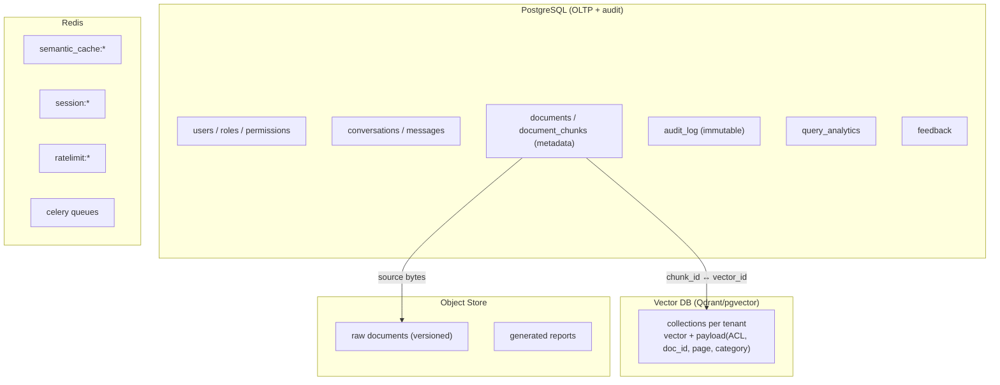

**Stores and rationale.**

- **PostgreSQL** — system of record for relational, transactional, and audit data. ACID guarantees for conversations, RBAC, and compliance audit.
- **Redis** — ephemeral, low-latency: caches, sessions, rate-limit counters, task queues.
- **Vector Database** — embeddings + ANN. Payload metadata enables filtered search (tenant, category, ACL) and links back to `document_chunks`.
- **Document Store (object storage)** — immutable, versioned raw documents; generated report artefacts.
- **Metadata Tables** — `documents`, `document_chunks` (page, section, part index, token count, checksum) — the join bridge between relational and vector worlds.
- **User Tables** — `users`, `roles`, `permissions`, `role_permissions` for RBAC.
- **Audit Tables** — append-only `audit_log` capturing `(actor, action, resource, route, grounded, confidence, sources, latency, ts, trace_id)` for regulatory review; write-once, retention-tiered.
- **Conversation Tables** — `conversations` and `messages` (role, content, citations, tokens, model, cost) for memory and history.

See the full ER diagram in Section 13.

---

## 7. AI Components

- **OpenAI / Azure OpenAI.** Primary generation via Azure OpenAI (enterprise data-residency, private networking, content filters). Public OpenAI as secondary/failover behind the Model Gateway. *(As-built: Azure `o4-mini`.)*
- **Embedding Model.** `text-embedding-3-large` (target) with MiniLM local fallback for air-gapped/dev. Embeddings versioned; dimension changes trigger re-indexing.
- **Reranker.** Cross-encoder reranking (bge-reranker / Cohere Rerank) between retrieval and synthesis to lift precision@n.
- **Prompt Templates.** Versioned, reviewed artefacts (system role, grounding contract, refusal contract, anti-verbatim rule, few-shot exemplars) managed in a prompt registry with A/B evaluation.
- **Conversation Memory.** Windowed recent-turn memory + optional summary memory for long sessions; stored in `messages`, injected within the token budget.
- **Guardrails.** Layered: input (PII detection, prompt-injection heuristics, scope routing), output (grounding + overlap thresholds, toxicity, policy), and escalation for sensitive intents.
- **Confidence Score.** Composite of routing similarity, retrieval scores, semantic grounding, and lexical overlap (Section 22).
- **Source Attribution.** Deterministic mapping from answer to contributing chunks with scores and snippets (Section 23).

---

## 8. Security

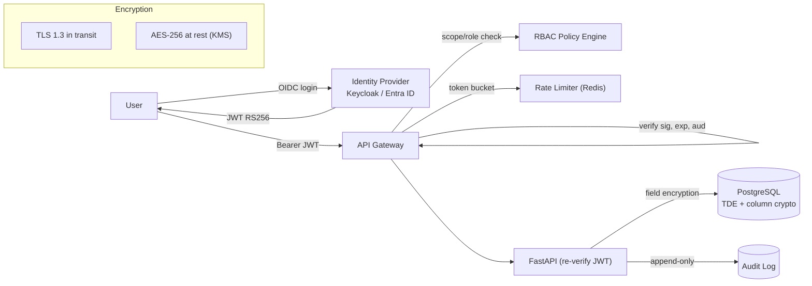

- **JWT.** Short-lived RS256 access tokens + rotating refresh tokens; verified at gateway and re-verified in-service (defence in depth).
- **RBAC.** Roles (`viewer`, `analyst`, `uploader`, `admin`, `auditor`) → scopes (`chat:invoke`, `docs:write`, `reports:read`, `audit:read`). Enforced at gateway and endpoint dependency level. Row-level tenant isolation in Postgres and payload-filtered vector search.
- **Encryption.** TLS 1.3 in transit; AES-256 at rest (KMS-managed keys, Postgres TDE + application-level column encryption for PII); secrets in Vault/Key Vault, never in env files.
- **Rate Limiting.** Distributed token-bucket per principal + per IP in Redis; separate quotas for expensive routes (upload, report, LLM).
- **Audit Logs.** Immutable, tamper-evident (hash-chained) records for every privileged action and every AI turn, satisfying banking compliance (RBI/GDPR/SOX-style controls).
- **Additional.** WAF at the edge, prompt-injection/PII input filtering, output DLP, content-safety filters, dependency and container image scanning, network policies (zero-trust east-west).

---

## 9. Deployment Architecture

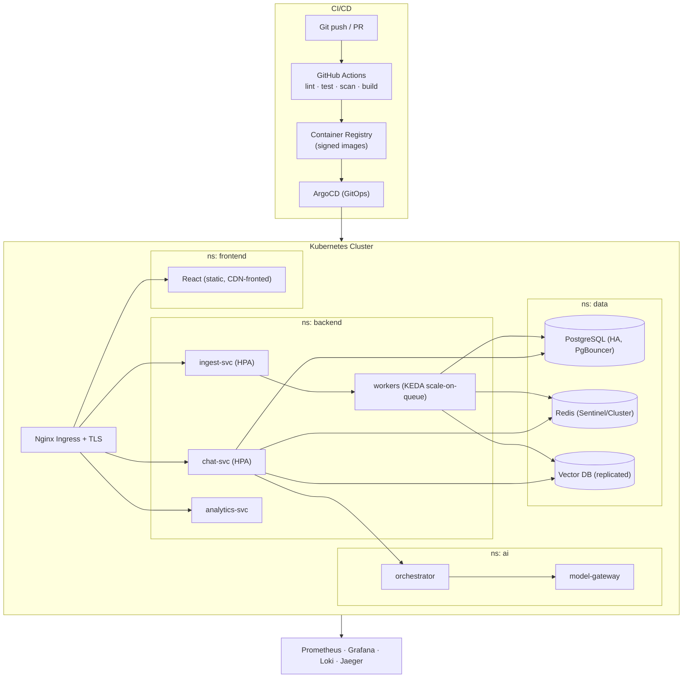

- **React** built to static assets, served via CDN/Nginx.
- **FastAPI** services containerised, run as HPA-scaled deployments; workers scaled by queue depth (KEDA).
- **Docker** multi-stage images (distroless runtime); **Nginx** ingress terminates TLS and routes.
- **Redis / PostgreSQL / Vector DB** run as HA stateful sets (or managed cloud services) with connection pooling (PgBouncer).
- **Kubernetes** provides orchestration, self-healing, rolling/canary deploys.
- **CI/CD** — GitHub Actions (build/test/scan/sign) → ArgoCD GitOps sync.
- **Monitoring** — Prometheus/Grafana (metrics), Loki (logs), Jaeger/Tempo (traces).

---

## 10. Sequence Diagrams

### 10.1 Document Upload

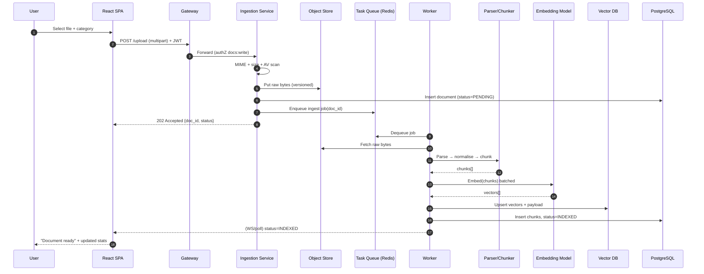

### 10.2 Question Answering

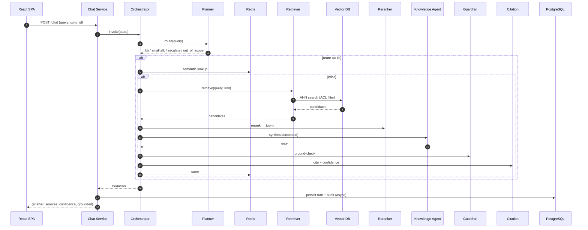

### 10.3 Report Generation

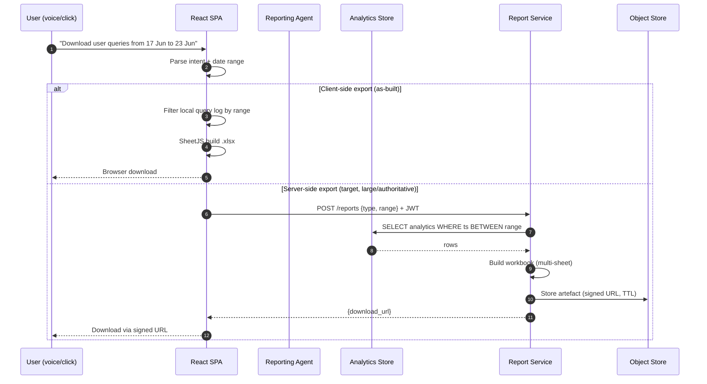

### 10.4 Dashboard Query

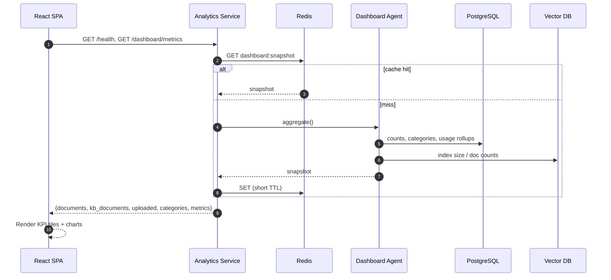

---

## 11. Infrastructure Diagram

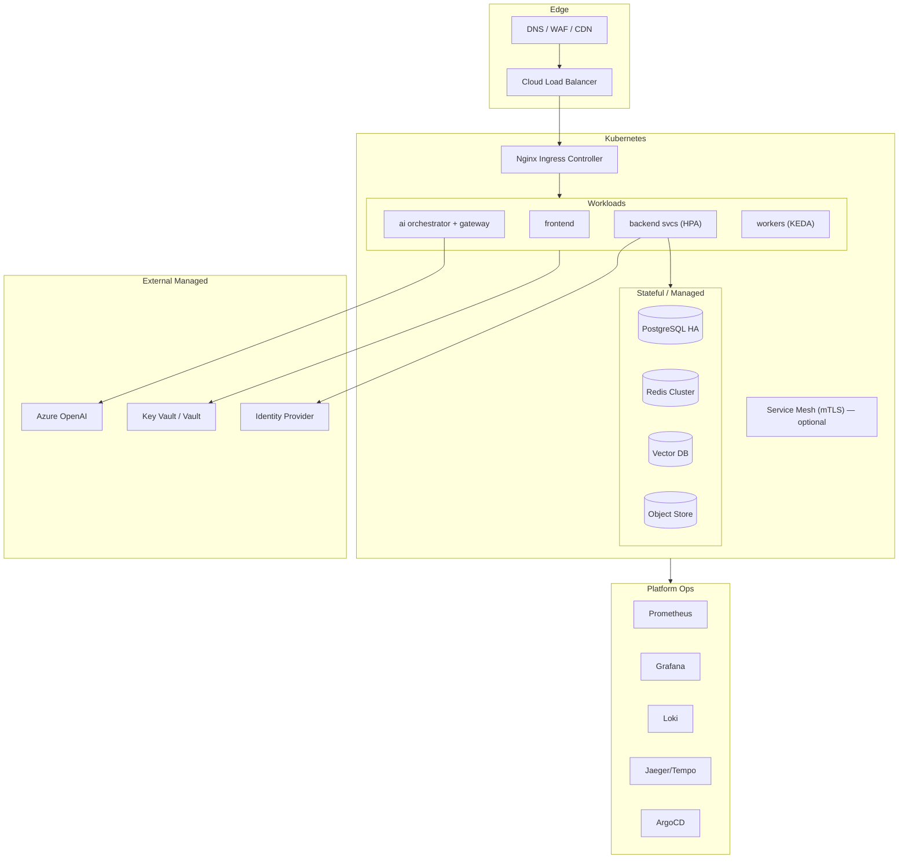

---

## 12. Component Diagram

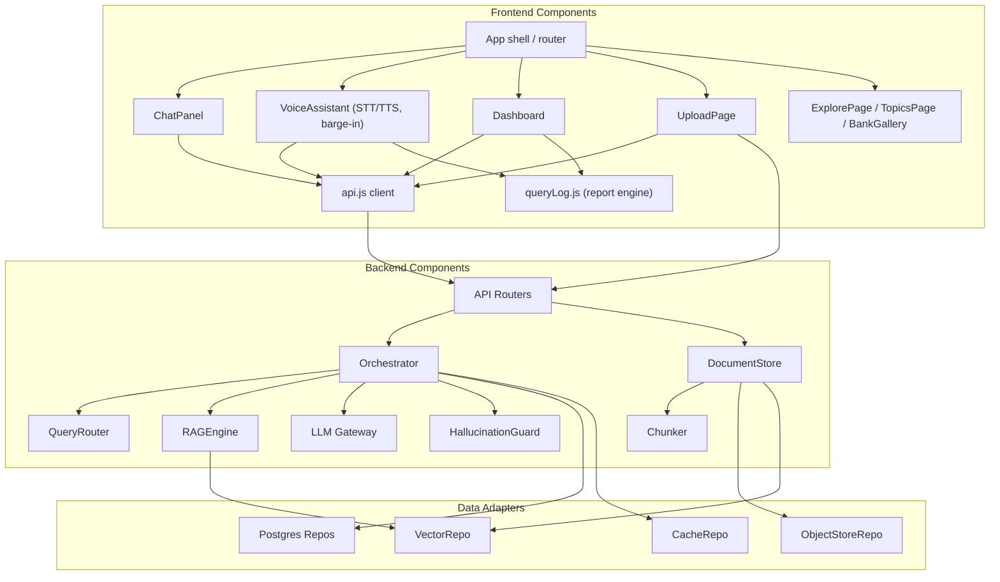

---

## 13. Database ER Diagram

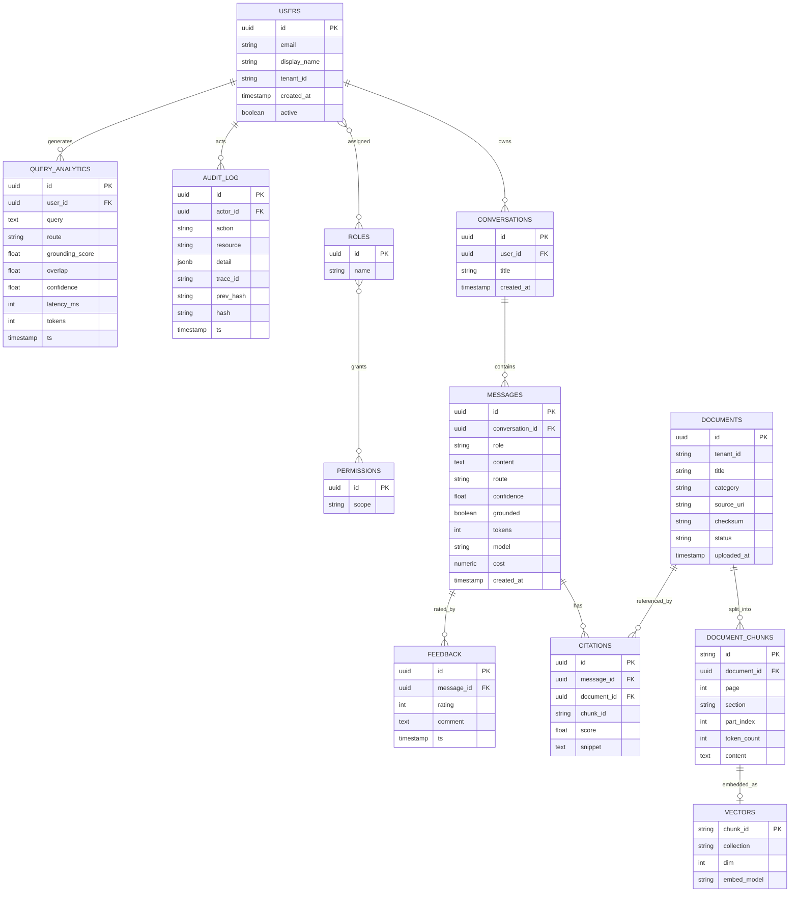

---

## 14. Folder Structure (Production-Grade)

```text
banking-rag-assistant/
├── frontend/
│   ├── src/
│   │   ├── components/         # ChatPanel, VoiceAssistant, Dashboard, Upload, Explore, ...
│   │   ├── api/                # typed API clients, ws client
│   │   ├── features/           # feature-scoped state/hooks
│   │   ├── lib/                # queryLog/report engine, formatters
│   │   └── routes/
│   ├── tests/                  # vitest + testing-library
│   └── Dockerfile
├── services/
│   ├── chat/                   # chat REST + ws
│   │   └── app/{api,domain,infra,agents}
│   ├── ingestion/              # upload + workers
│   ├── analytics/              # dashboard + reporting
│   └── auth/                   # OIDC/JWT/RBAC
├── libs/                       # shared python packages
│   ├── rag_core/               # rag_engine, chunker, embeddings
│   ├── agents/                 # planner, retriever, knowledge, guard, citation...
│   ├── model_gateway/          # provider adapters (azure/openai/local)
│   ├── guardrails/             # hallucination guard, PII, injection
│   ├── schemas/                # pydantic contracts
│   └── observability/          # otel, logging, metrics
├── db/
│   ├── migrations/             # alembic
│   └── seeds/
├── deploy/
│   ├── docker/                 # Dockerfiles, compose (local)
│   ├── helm/                   # charts per service
│   ├── k8s/                    # base + overlays (kustomize)
│   └── argocd/
├── infra/                      # terraform (cluster, db, vector, kv)
├── prompts/                    # versioned prompt templates + evals
├── tests/                      # integration, e2e, load (locust/k6)
├── .github/workflows/          # CI pipelines
└── docs/                       # this document, ADRs, runbooks
```

---

## 15. API Flow

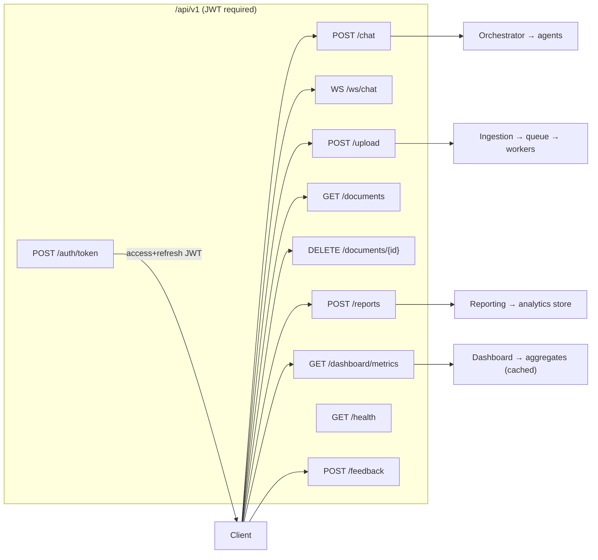

**Representative contracts.**

- `POST /api/v1/chat` → `{query, conversation_id?, top_k?}` ⇒ `{answer, route, grounded, grounding_score, overlap, confidence, sources[], latency_ms}`
- `POST /api/v1/upload` (multipart `file`, `category?`) ⇒ `202 {document_id, status}`
- `GET /api/v1/documents` ⇒ `{uploads[], chunks, files}`
- `DELETE /api/v1/documents/{id}` ⇒ `{deleted: true}` (triggers vector purge + reindex)
- `POST /api/v1/reports` → `{type, date_range, filters}` ⇒ `{download_url}`
- `GET /api/v1/health` ⇒ `{status, documents, kb_documents, uploaded_chunks, uploaded_files, categories[]}`

---

## 16. Microservices — Responsibilities

| Service | Responsibility | Scaling signal |
|---|---|---|
| **Chat Service** | Synchronous + streaming Q&A; hosts the orchestrator entrypoint; enforces per-turn budgets. | CPU + concurrent requests / p95 latency |
| **Ingestion Service** | Upload intake, validation, object-store write, job enqueue; exposes document CRUD. | Upload rate; workers scale on queue depth |
| **Analytics/Reporting Service** | Dashboard aggregation, usage metrics, report generation/export. | Read QPS; scheduled rollups |
| **Auth Service** | OIDC integration, token issuance/refresh, RBAC policy decisions. | Login rate |
| **Model Gateway** | Provider abstraction (Azure/OpenAI/local), retries, timeouts, failover, cost/latency routing, rate-limit shielding. | LLM QPS; provider quotas |
| **Orchestrator (AI)** | LangGraph execution of the agent graph; state management; conditional routing. | Co-scaled with Chat |
| **Workers** | Async parse/chunk/embed/upsert/reindex; report builds. | Queue depth (KEDA) |

Services communicate via REST/gRPC internally, share async work through the broker, and are independently deployable and versioned.

---

## 17. Scalability

- **Stateless services** → horizontal scale via HPA on CPU + custom metrics (p95 latency, in-flight requests). Session state externalised to Redis.
- **Async offload** → all heavy ingestion/embedding work runs in workers scaled on queue depth (KEDA), decoupling upload latency from indexing throughput.
- **Vector DB scaling** → sharded/replicated collections, HNSW parameters tuned per recall/latency SLO; read replicas for query fan-out.
- **Database scaling** → PgBouncer pooling, read replicas for analytics, partitioning of high-volume tables (`audit_log`, `query_analytics`) by time; CQRS split for reporting.
- **Caching** → semantic + retrieval + embedding caches absorb repeat load and cut LLM spend.
- **Provider throughput** → Model Gateway load-balances across deployments/regions, enforces concurrency caps, and degrades gracefully under quota pressure.
- **Multi-tenancy** → tenant-scoped collections and row-level security enable per-tenant isolation and independent scaling.

---

## 18. Fault Tolerance

- **Graceful degradation ladder** (mirrors the real code's fallback philosophy): Azure LLM → alternate deployment/region → OpenAI → **local extractive/refusal fallback**. The system never hard-fails a query; it returns a safe, honest response.
- **Retries with backoff + jitter** on provider and DB calls; **circuit breakers** on the Model Gateway to shed load when a provider degrades.
- **Idempotent ingestion** keyed by document checksum; **dead-letter queues** for poison messages; jobs resumable.
- **Timeouts everywhere** (connect/read budgets already present as `OPENAI_CONNECT_TIMEOUT`/`READ_TIMEOUT`) to bound tail latency.
- **HA data stores** — Postgres with sync replica + automated failover; Redis Sentinel/Cluster; vector DB replicas.
- **Kubernetes self-healing** — liveness/readiness probes, PodDisruptionBudgets, multi-AZ spread, rolling/canary deploys with automated rollback.
- **Backups & DR** — PITR for Postgres, versioned object storage, periodic vector index snapshots; documented RPO/RTO.

---

## 19. Caching

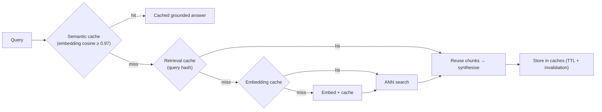

- **Semantic answer cache** — normalised-query embedding matched by cosine ≥ threshold; returns full grounded response. Biggest cost/latency win.
- **Retrieval cache** — maps query hash → chunk IDs, avoiding repeat ANN searches.
- **Embedding cache** — caches vectors for identical text (queries and chunks).
- **Provider/response cache** — short-TTL cache of deterministic LLM calls.
- **Dashboard cache** — short-TTL aggregate snapshot.
- **Invalidation** — document upload/delete purges affected retrieval/semantic entries (tag-based invalidation keyed by `doc_id`/`category`); TTLs bound staleness.

---

## 20. Query Routing

The Planner classifies before any expensive work — deterministic and audit-friendly, matching the implemented `QueryRouter`.

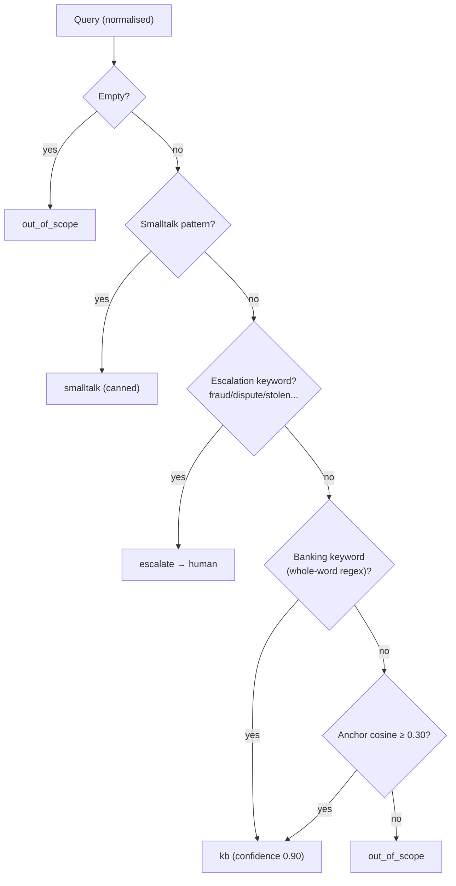

**Design notes.** The key production lesson (implemented): terse banking questions ("For NRI applicants?") and off-topic text overlap in embedding-similarity space, so a **deterministic whole-word keyword fast-path** precedes the semantic gate. The semantic anchor similarity is only a fallback for keyword-less queries. Escalation intents (fraud/dispute) bypass the KB entirely and route to human/agent handling. Target-state adds `report` and `dashboard` intents and an LLM-based zero-shot classifier as a tertiary tie-breaker with confidence calibration.

---

## 21. Hallucination Detection

Two-stage, post-generation validation with refusal preservation — the implemented `HallucinationGuard`, generalised.

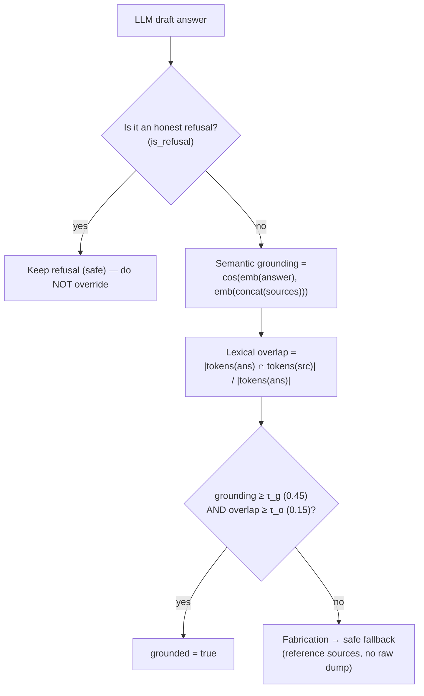

**Mechanism.**
1. **Refusal preservation.** If the model honestly declines ("not in our knowledge base"), that reply is safe and is **never** replaced — a correctness fix learned from the real system, where the guard previously overrode honest refusals with raw chunk dumps.
2. **Semantic grounding.** Cosine similarity between the answer embedding and the concatenated source embedding; must clear `τ_g` (0.45).
3. **Lexical overlap.** Content-word (stop-word-filtered) overlap fraction; must clear `τ_o` (0.15) to catch fluent drift.
4. **Fallback.** Genuine fabrications are replaced by a safe message that *names* the closest documents rather than pasting raw, noisy text.

**Target enhancements.** Sentence-level NLI entailment (each claim entailed by ≥1 source), self-consistency sampling, and LLM-as-judge groundedness scoring, with thresholds calibrated on a labelled eval set.

---

## 22. Confidence Score Calculation

Confidence is a **composite** of independent signals, not a single model probability — appropriate for a compliance-sensitive domain.

```
route_conf      = max anchor/keyword routing confidence          ∈ [0,1]
retrieval_conf  = normalised top-1 (or mean top-n) ANN score      ∈ [0,1]
grounding_score = cos(emb(answer), emb(sources))                  ∈ [0,1]
overlap         = |content_tokens(ans) ∩ src| / |content_tokens(ans)| ∈ [0,1]

confidence = w1·route_conf + w2·retrieval_conf
           + w3·grounding_score + w4·overlap        (Σ wᵢ = 1)

# Hard gate: if not grounded → confidence is capped (e.g. ≤ 0.3)
```

- As-built exposes `confidence` (routing), `grounding_score`, and `overlap` on every `/chat` response; the frontend renders them (e.g., `g=0.67`, `conf 0.60`, grounded badge).
- Target-state fits weights `w1..w4` via logistic regression against human-labelled correctness, producing a **calibrated** probability (Platt/isotonic), and surfaces confidence bands (High/Medium/Low) rather than raw floats to end users.

---

## 23. Source Citation Generation

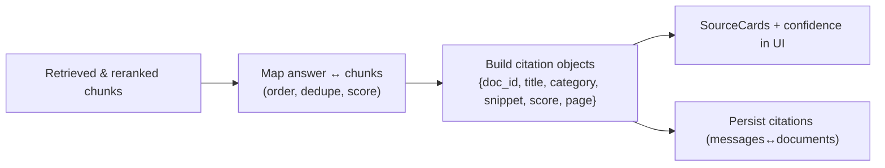

- Each surviving chunk becomes a citation: `{id, title, category, snippet(≤240 chars), score}` — exactly the payload the current `/chat` handler returns and the frontend `SourceCard` renders.
- **Deterministic** attribution: sources are the reranked chunks that entered the context window, ordered by relevance, deduplicated by document.
- **Traceability**: citations are persisted (`messages ↔ citations ↔ documents`) so every answer is auditable back to source page/section.
- **Target enhancement**: span-level attribution — align answer sentences to specific source spans (embedding overlap / NLI), enabling inline footnote-style citations and "show evidence" highlighting.

---

## 24. Observability

```mermaid
flowchart LR
    subgraph SIGNALS["Three Pillars + AI"]
        M["Metrics (Prometheus)"]
        L["Logs (Loki/ELK, JSON)"]
        T["Traces (OTel → Jaeger)"]
        AIQ["AI Quality (evals)"]
    end
    APP["All services (OTel SDK)"] --> M & L & T
    APP --> AIQ
    M & L & T --> GRAF["Grafana dashboards + alerts"]
    AIQ --> EVAL["Eval dashboard: grounding rate, deflection, CSAT"]
```

- **Metrics** — RED per endpoint + AI KPIs: grounding rate, refusal rate, cache hit ratio, tokens/turn, cost/turn, retrieval recall proxy, p50/p95/p99 latency (split by stage: retrieve/rerank/generate/guard).
- **Logs** — structured JSON with trace correlation and PII redaction; every AI turn logged with route, scores, model, and decision path.
- **Traces** — distributed tracing spans the full path (gateway → orchestrator → agents → providers/DB), making per-stage latency attribution trivial.
- **AI quality/evals** — offline eval harness on a golden Q&A set (faithfulness, answer relevance, context precision/recall à la RAGAS); online guardrail telemetry; user feedback (`/feedback`) closes the loop.
- **Alerting/SLOs** — error-budget-based alerts on latency, grounding-rate regression, provider errors, queue backlog; runbooks per alert.

---

## 25. Enterprise-Grade Improvements (Roadmap)

**Retrieval & quality**
1. Add a **cross-encoder reranker** — highest-ROI precision lift over raw ANN order.
2. **Layout-aware parsing** (Document Intelligence/Unstructured) to fix table-heavy banking PDFs; **semantic + structural chunking** with metadata.
3. **Hybrid search** (BM25 + dense) with reciprocal-rank fusion for terse/keyword queries.
4. **Query rewriting / HyDE** and multi-query expansion for recall.

**Platform**
5. Replace in-process FAISS with a **managed vector DB** (HNSW, replication, filtered search, per-tenant isolation).
6. Introduce the **LangGraph orchestrator** + **Model Gateway** (multi-provider failover, cost routing, semantic caching).
7. **Streaming responses** over WebSocket end-to-end (already fits the voice barge-in UX).

**Governance & trust**
8. **Calibrated confidence** and **span-level citations** with "show evidence".
9. **NLI-based groundedness** + LLM-as-judge, thresholds tuned on labelled evals.
10. **Prompt registry** with versioning, A/B testing, and regression evals in CI.
11. Full **AuthN/Z, RBAC, audit, encryption** as specified (Sections 8, 13).

**Operations**
12. **Golden-set eval gates** in CI/CD (block deploys on grounding-rate regression).
13. **Feedback-driven retraining** loop (thumbs up/down → eval set → prompt/threshold tuning).
14. **Cost governance** — per-tenant token budgets, cache-first policy, model tiering (cheap model for easy routes).
15. **Data lifecycle & compliance** — retention tiers, right-to-erasure, PII vaulting, model/content audit for RBI/GDPR.

---

## Table of Contents

0. [Preamble — As-Built vs. Target-State](#0-preamble--as-built-vs-target-state)
1. [High-Level Architecture](#1-high-level-architecture)
2. [End-to-End Request Flow — *"How do I get a personal loan?"*](#2-end-to-end-request-flow--how-do-i-get-a-personal-loan)
3. [RAG Pipeline](#3-rag-pipeline)
4. [Agent Architecture](#4-agent-architecture)
5. [Backend Components](#5-backend-components)
6. [Database Design](#6-database-design)
7. [AI Components](#7-ai-components)
8. [Security](#8-security)
9. [Deployment Architecture](#9-deployment-architecture)
10. [Sequence Diagrams](#10-sequence-diagrams)
    - 10.1 Document Upload
    - 10.2 Question Answering
    - 10.3 Report Generation
    - 10.4 Dashboard Query
11. [Infrastructure Diagram](#11-infrastructure-diagram)
12. [Component Diagram](#12-component-diagram)
13. [Database ER Diagram](#13-database-er-diagram)
14. [Folder Structure (Production-Grade)](#14-folder-structure-production-grade)
15. [API Flow](#15-api-flow)
16. [Microservices — Responsibilities](#16-microservices--responsibilities)
17. [Scalability](#17-scalability)
18. [Fault Tolerance](#18-fault-tolerance)
19. [Caching](#19-caching)
20. [Query Routing](#20-query-routing)
21. [Hallucination Detection](#21-hallucination-detection)
22. [Confidence Score Calculation](#22-confidence-score-calculation)
23. [Source Citation Generation](#23-source-citation-generation)
24. [Observability](#24-observability)
25. [Enterprise-Grade Improvements (Roadmap)](#25-enterprise-grade-improvements-roadmap)

---

*End of document.*
